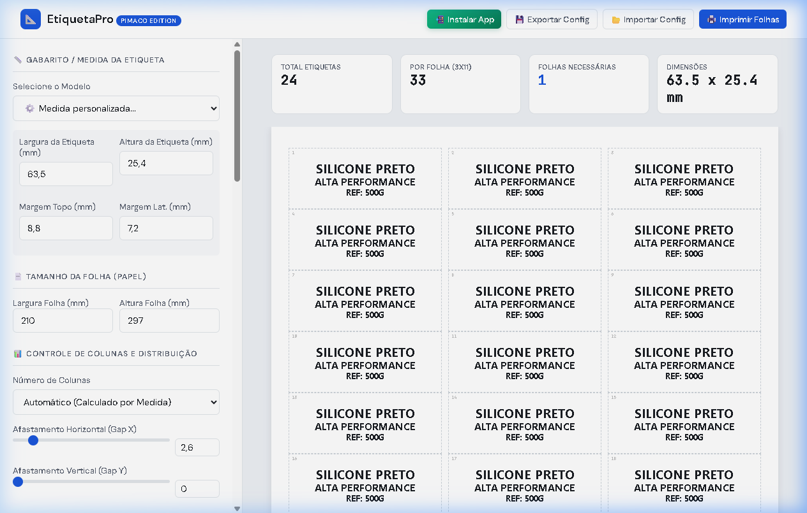
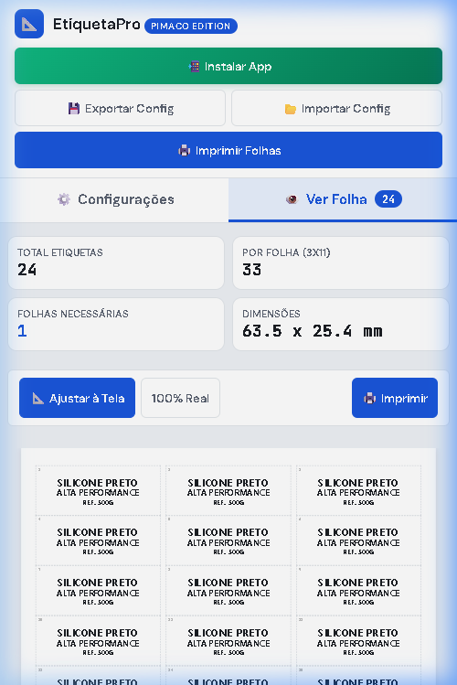
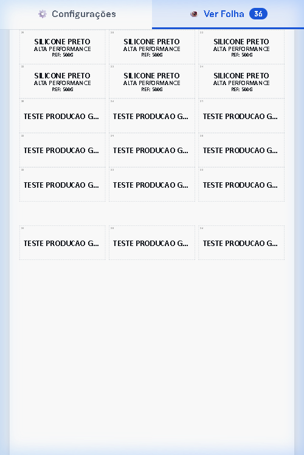
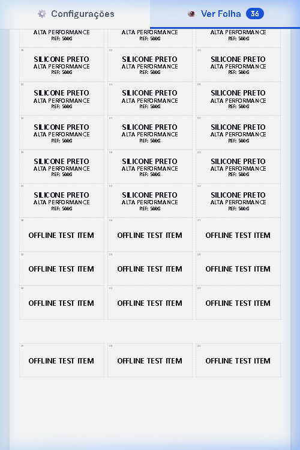

# 📐 EtiquetaPro

[](https://wallacextreme.github.io/etiquetapro/)
[](https://wallacextreme.github.io/etiquetapro/manifest.json)
[](https://wallacextreme.github.io/etiquetapro/sw.js)
[](https://developer.mozilla.org/pt-BR/docs/Web/JavaScript)

Aplicação web para geração e impressão de etiquetas autoadesivas com precisão milimétrica, suporte a gabaritos oficiais Pimaco (folhas A4 e Carta), medidas personalizadas, Progressive Web App (PWA) instalável em dispositivos móveis e funcionamento offline após o primeiro carregamento.

---

## 🔗 Acesso Rápido

- **🚀 Aplicação em Produção**: [https://wallacextreme.github.io/etiquetapro/](https://wallacextreme.github.io/etiquetapro/)
- **💻 Código-Fonte no GitHub**: [https://github.com/wallacextreme/etiquetapro](https://github.com/wallacextreme/etiquetapro)

---

## 🎯 Sobre o Projeto

Criar folhas de etiquetas para impressoras comuns costuma ser um processo demorado, sujeito a erros de alinhamento em softwares de edição de texto ou dependente de programas proprietários pesados.

O **EtiquetaPro** foi desenvolvido para resolver esse problema diretamente no navegador:
1. Permite escolher o modelo exato da etiqueta (catálogo Pimaco ou medidas sob medida).
2. Adiciona múltiplos produtos e quantidades em uma fila de impressão.
3. Calcula a distribuição matemática de linhas e colunas, gerando automaticamente a quantidade exata de páginas necessárias.
4. Envia o documento para impressão física via `window.print()` sem distorções de margens.
5. Permite instalação no smartphone como aplicativo (PWA) e uso sem conexão de rede.

---

## 📸 Demonstração Visual

| Layout Desktop | Visualização Mobile com Abas |
| :---: | :---: |
|  |  |

| Ajuste de Folha na Tela (Fit-to-Screen) | Funcionamento em Modo Offline |
| :---: | :---: |
|  |  |

---

## ⚡ Principais Recursos

- **📐 Precisão Milimétrica**: Utilização de unidades físicas `mm` em CSS Grid e regra dinâmica `@page` injetada em tempo de execução.
- **🏷️ 21 Gabaritos Pimaco Homologados**:
  - **11 Modelos A4 (210 × 297 mm)**: A4056 (33/folha), A4054 (22/folha), A4060 (21/folha), A4062 (16/folha), A4063 (14/folha), A4051 (65/folha), A4261 (18/folha), A4264 (12/folha), A4265 (8/folha), A4268 (2/folha) e A4067 (1/folha).
  - **10 Modelos Carta (215,9 × 279,4 mm)**: 6080 (30/folha), 6081 (20/folha), 6082 (14/folha), 6083 (10/folha), 6084 (6/folha), 6087 (80/folha), 6089 (60/folha), 6095 (8/folha), 8096 (9/folha) e 8098 (12/folha).
  - Modo de **Medida Personalizada (Custom)** com controle livre de largura, altura, margem superior, margem lateral e afastamentos (gaps).
- **📋 Fila de Impressão Dinâmica**: Adição e remoção de múltiplos itens com quantidades independentes, distribuídos continuamente por quantas páginas forem necessárias (`break-after: page`).
- **🎨 Tipografia e Identidade Visual**:
  - Fontes customizáveis, alinhamento, estilos (negrito, itálico, sublinhado, sombra).
  - Paleta de cores para texto, fundo e bordas, além de temas rápidos pré-configurados.
  - Upload de logotipos locais via `FileReader` com matriz de posicionamento em 9 quadrantes.
  - Modos de impressão: Completo (Texto + Logo), Apenas Texto ou Somente Logo.
- **💾 Portabilidade**: Exportação e importação de configurações completas em formato JSON com tratamento de erros.
- **📱 PWA & Mobile UX**:
  - Sistema de abas no celular: **⚙️ Configurações** e **👁️ Ver Folha**.
  - Ajuste proporcional de tela (*Fit-to-Screen*) sem alterar as medidas de impressão física.
  - Botão de instalação nativa no aplicativo.

---

## 🛠️ Tecnologias Utilizadas

```text
Frontend
├── HTML5 Semântico (Paged Media, Viewport Cover)
├── CSS3 Puro (CSS Grid, Flexbox, Variáveis CSS, Media Queries, @page, @media print)
└── JavaScript Vanilla (ES6+, DOM API, FileReader, JSON API)

PWA & Armazenamento Local
├── Web App Manifest (manifest.json, modo standalone, ícones adaptativos)
├── Service Worker API (sw.js, ciclo de vida install/activate/fetch)
└── Cache Storage API (estratégia Stale-While-Revalidate)

Deploy & CI/CD
├── GitHub Pages (Hospedagem estática com HTTPS nativo)
└── GitHub Actions (.github/workflows/pages.yml)
```

> **Sem dependências externas**: O aplicativo não utiliza frameworks pesados (React, Vue, Angular), bundlers complexos ou CDNs que possam falhar em redes instáveis.

---

## 💡 Destaques Técnicos

1. **Desacoplamento entre Escala Visual e Medidas Físicas**:
   No celular, uma folha A4 física (210 mm $\approx$ 794 px) é reduzida visualmente via CSS `transform: scale()` para caber em telas estreitas (360 px a 412 px). No entanto, na regra `@media print`, o `transform` é explicitamente neutralizado (`transform: none !important;`), assegurando que a impressora receba os milímetros reais sem qualquer distorção.
2. **Funcionamento Offline Real**:
   O `sw.js` executa o pré-cache de todos os arquivos estáticos essenciais durante o evento `install`. Em requisições subsequentes, os recursos são servidos diretamente do Cache Storage local, permitindo que o aplicativo abra e opere normalmente sem conexão com a internet.
3. **Cálculo Preciso de Grid**:
   A paginação utiliza fórmulas matemáticas para determinar a quantidade máxima de colunas e linhas que cabem fisicamente no papel, respeitando margens e gaps sem transbordar.

---

## 📲 Como Instalar no Android

1. Abra a aplicação no Google Chrome: [https://wallacextreme.github.io/etiquetapro/](https://wallacextreme.github.io/etiquetapro/)
2. Toque no botão **"📲 Instalar App"** no topo da tela (ou abra o menu do Chrome e selecione **"Instalar aplicativo"** / **"Adicionar à tela inicial"**).
3. O ícone do **EtiquetaPro** será adicionado à tela inicial e à gaveta de apps do aparelho.
4. **Para testar offline**: Ative o Modo Avião do celular e abra o EtiquetaPro pelo ícone instalado. O aplicativo iniciará e permitirá gerar folhas normalmente sem internet.

---

## 💻 Como Executar Localmente

Como o projeto utiliza tecnologias web puras, não é necessário instalar dependências com `npm`:

1. Clone o repositório:
   ```bash
   git clone https://github.com/wallacextreme/etiquetapro.git
   cd etiquetapro
   ```
2. Inicie um servidor HTTP local simples (necessário para o Service Worker operar):
   ```bash
   # Com Python 3
   python -m http.server 8080

   # Ou com Node.js (npx)
   npx serve .
   ```
3. Abra `http://localhost:8080` no navegador.

---

## 🧪 Validação e Testes Realizados

| Área Auditada | Status | Descrição do Teste |
| :--- | :---: | :--- |
| **Desktop (1920 × 1080)** | ✅ Aprovado | Layout de duas colunas (painel 380px + prévia da folha), todos os controles operacionais. |
| **Mobile (360px a 412px)** | ✅ Aprovado | Abas táteis de 48px, formulário em coluna única, 0px de overflow lateral. |
| **Ajuste de Folha (Fit-to-Screen)** | ✅ Aprovado | Folha A4 centralizada e escalada proporcionalmente no celular. |
| **Modo Offline** | ✅ Aprovado | Testado com servidor de rede desligado; recarregamento e geração de etiquetas funcionando. |
| **Service Worker & Cache** | ✅ Aprovado | 10 assets armazenados no Cache Storage `etiquetapro-v1.0.1`, ativação imediata (`clients.claim`). |
| **Web App Manifest** | ✅ Aprovado | Modo standalone, ícones 192, 512 e maskable com safe zone 80% validados. |
| **Precisão de Impressão** | ✅ Aprovado | `@media print` isolada da interface, regra `@page` injetada dinamicamente com medidas milimétricas. |
| **Gabaritos Pimaco (21 modelos)** | ✅ Aprovado | 11 modelos A4 e 10 modelos Carta com cálculos geométricos homologados. |
| **GitHub Pages & CI/CD** | ✅ Aprovado | Deploy automático via GitHub Actions com HTTPS forçado. |
| **Segurança do Código** | ✅ Aprovado | 0 credenciais, chaves de API, senhas ou tokens expostos. |

---

## 📚 Documentação Técnica Detalhada

Para aprofundar nos critérios de engenharia e decisões de projeto, consulte a pasta [`docs/`](docs/):

- [📖 Arquitetura do Software](docs/ARCHITECTURE.md)
- [📲 Especificação PWA e Service Worker](docs/PWA.md)
- [📱 Engenharia de Responsividade Mobile](docs/MOBILE.md)
- [🖨️ Motor de Impressão Milimétrica](docs/PRINTING.md)
- [🧪 Matriz de Testes](docs/TESTING.md)
- [🔍 Relatório do Quality Gate](docs/PWA-FINAL-QUALITY-GATE.md)
- [🚀 Relatório de Deploy em Produção](docs/PWA-PRODUCTION-DEPLOY.md)

---

## 🎓 Competências Técnicas Demonstradas

Este projeto foi estruturado como demonstração prática das seguintes competências em desenvolvimento front-end:

- **Desenvolvimento Front-End Vanilla**: Domínio de HTML5 semântico, CSS3 avançado (Grid, Flexbox, Media Queries) e JavaScript moderno sem muletas de frameworks.
- **Manipulação do DOM e Estado Local**: Gerenciamento reativo de estado na memória do cliente com sincronização em tempo real de inputs e elementos renderizados.
- **Progressive Web Apps (PWA)**: Implementação do ciclo de vida de Service Workers, estratégias de Cache Storage e configuração de Web App Manifests.
- **Design Responsivo & Mobile First**: Adaptação de layouts densos para telas pequenas utilizando navegação por abas, áreas de toque recomendadas ($\ge 44$px) e Safe Areas.
- **CSS para Mídia Impressa (Paged Media)**: Resolução de desafios de precisão física utilizando unidades milimétricas (`mm`), quebras de página e regras dinâmicas `@page`.
- **Git e CI/CD**: Versionamento semântico, controle de branches, automação de deploys com GitHub Actions e publicação no GitHub Pages.

---

## 👤 Autor

Desenvolvido por **Wallace Soares** como parte de seu portfólio de projetos web.

- **GitHub**: [@wallacextreme](https://github.com/wallacextreme)
- **Projeto Online**: [https://wallacextreme.github.io/etiquetapro/](https://wallacextreme.github.io/etiquetapro/)
