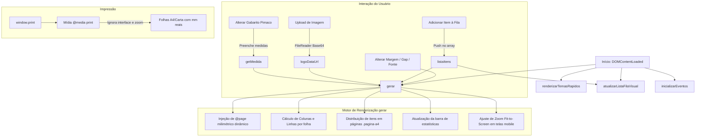

# Arquitetura do EtiquetaPro

Este documento detalha a arquitetura de software, fluxo de dados, estrutura de arquivos e decisões técnicas do **EtiquetaPro — Gerador Múltiplo de Etiquetas Customizadas**.

---

## 1. Visão Geral e Filosofia Arquitetural

O EtiquetaPro é uma Single Page Application (SPA) desenvolvida com foco em **alta fidelidade de impressão milimétrica**, **arquitetura Local-First/Offline-First**, **código limpo em JavaScript Vanilla** e **zero dependências pesadas de terceiros**.

### Princípios Chave:
- **Zero Framework Bloat**: Construído puramente com HTML5 semântico, CSS3 moderno e Vanilla JavaScript (ES6+).
- **Sem Backend / Banco de Dados**: Todo o processamento de layout, geração de folhas, cálculo de distribuição e armazenamento de logo ocorre na memória do cliente e navegador.
- **Isolamento entre Escala Visual e Medidas Físicas**: A visualização em tela (desktop ou smartphone) e a mídia de impressão física (`@media print`) são desacopladas, garantindo que o zoom ou compactação em tela de celular jamais afete a precisão física dos milímetros no papel.

---

## 2. Estrutura do Projeto

```text
EtiquetaPro/
├── index.html                  # Ponto de entrada oficial da aplicação
├── Etiquetas A4.html           # Arquivo sincronizado com o index
├── manifest.json               # Web App Manifest com configurações PWA e ícones
├── sw.js                       # Service Worker com estratégia Stale-While-Revalidate
├── offline.html                # Página de fallback para recursos desconectados
├── favicon.ico                 # Ícone do navegador multi-tamanho
├── .nojekyll                   # Sinalizador para o GitHub Pages ignorar Jekyll
│
├── icons/                      # Ícones em alta resolução para PWA e Android
│   ├── icon-192.png            # Ícone 192x192 para Android
│   ├── icon-512.png            # Ícone 512x512 para splash screen e desktop
│   ├── icon-maskable-512.png   # Ícone adaptativo para Android (safe zone 80%)
│   └── favicon.png             # Ícone PNG 64x64
│
├── docs/                       # Documentação técnica de engenharia
│   ├── ARCHITECTURE.md         # Este documento
│   ├── PWA.md                  # Especificação PWA e Service Worker
│   ├── MOBILE.md               # Responsividade, abas e fit-to-screen
│   ├── PRINTING.md             # Motor de impressão milimétrica A4/Carta
│   └── TESTING.md              # Plano e resultados dos testes de qualidade
│
├── .github/
│   └── workflows/
│       └── pages.yml           # CI/CD automatizado para deploy no GitHub Pages
│
├── README.md                   # Apresentação profissional do portfólio
└── CHANGELOG.md                # Registro histórico de alterações
```

---

## 3. Fluxo de Dados e Ciclo de Vida da Aplicação



---

## 4. Componentes e Responsabilidades

### 4.1. Catálogo Oficial Pimaco (`PIMACO_TEMPLATES`)
Objeto imutável contendo as especificações milimétricas oficiais de gabaritos Pimaco para folha A4 e Carta:
- **A4 (210 × 297 mm)**: A4056 (33/folha), A4054 (22/folha), A4060 (21/folha), A4062 (16/folha), A4063 (14/folha), A4051 (65/folha), A4261 (18/folha), A4264 (12/folha), A4265 (8/folha), A4268 (2/folha), A4067 (1/folha).
- **Carta (215.9 × 279.4 mm)**: 6080 (30/folha), 6081 (20/folha), 6082 (14/folha), 6083 (10/folha), 6084 (6/folha), 6087 (80/folha), 6089 (60/folha), 6095 (8/folha), 8096 (9/folha), 8098 (12/folha).

### 4.2. Fila de Impressão (`listaItens`)
Estrutura de dados contendo os produtos ou textos a serem impressos:
```javascript
{
  linha1: string, // Texto principal (maior destaque)
  linha2: string, // Linha secundária (subtítulo/detalhes)
  linha3: string, // Linha terciária (código/ref/peso)
  qtd: number     // Quantidade de etiquetas deste item
}
```
O gerador itera sobre cada item e sua quantidade, alocando-os sequencialmente nas páginas `.pagina-a4`.

### 4.3. Motor de Paginação Milimétrica
A função `gerar()` calcula:
$$\text{colunas} = \left\lfloor \frac{(\text{folhaW} - 2 \times \text{ml}) + 0.1 + \text{gapX}}{\text{w} + \text{gapX}} \right\rfloor$$
$$\text{linhas} = \left\lfloor \frac{(\text{folhaH} - 2 \times \text{mt}) + 0.1 + \text{gapY}}{\text{h} + \text{gapY}} \right\rfloor$$
$$\text{totalPorFolha} = \text{colunas} \times \text{linhas}$$

Quando a quantidade de etiquetas preenchidas em uma página atinge `totalPorFolha`, uma nova folha `.pagina-a4` é criada no DOM, com regra CSS de quebra de página:
```css
page-break-after: always;
break-after: page;
```

---

## 5. Exportação e Importação de Configuração (JSON)

O estado completo do aplicativo (itens na fila, modelo, medidas personalizadas, tipografia, cores, bordas, tamanho e posição da logo) pode ser exportado e importado via JSON nativo:
- Serialização via `JSON.stringify(config, null, 2)`
- Desserialização e hidratação segura via `JSON.parse()` com bloco `try/catch` e notificação via `toast()`.
